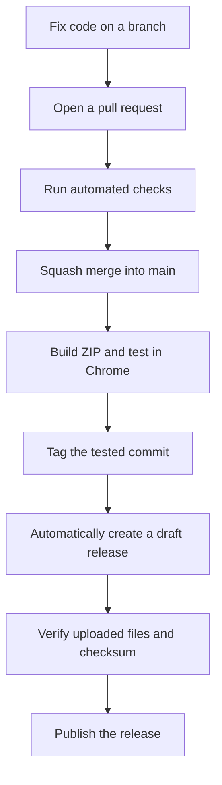

# Understanding the release workflow

This guide explains the Git and GitHub features used to make YT Ad Skip's
releases traceable, tested, easy to install, and safer to maintain. It uses the
first public release, [v1.0.0](https://github.com/cupok/yt-ad-skip/releases/tag/v1.0.0),
as a concrete example.

Repository settings were checked on **2026-10-21**. Settings and test counts can
change; this is a dated explanation of the setup, not a live status page.
For the commands to prepare the next release, read [RELEASING.md](../RELEASING.md).

## The process at a glance



For the first release, making the repository public was a separate visibility
change. We also enabled security features. Future releases do not need another
visibility change.

## 1. Commits, branches, pushes, and pull requests

A **commit** records a project snapshot, its author, message, and relationship
to earlier commits. Its hash identifies that commit. The code released as
`v1.0.0` is commit `f134c6c`.

A **branch** is a movable name pointing to a line of development. We worked on
`fix/paused-skip-countdown` while `main` represented the accepted project state.
A **push** sends local commits or tags to the remote repository on GitHub.

A **pull request**, or PR, proposes bringing changes from one branch into
another. It provides a place to inspect the diff, discuss the change, and see
check results before merging. Contributors without write access can propose
changes through PRs from their own forks.

We use Conventional Commits for commit messages and PR titles, for example:

```text
fix(skipping): preserve countdown while paused
docs: clarify release installation
```

This makes the purpose of a change easier to understand from the history.

## 2. Squash merging and branch cleanup

**Squash and merge** puts the complete PR into one new commit on `main`.
It creates a new commit even when the PR contains only one original commit.
For the countdown fixes, the original branch commit was `6363ee4`, and the
squash commit on `main` was `f134c6c`.

The two commits can have the same title. An all-branches Git log can show both
while the original branch exists. The changes are applied once on `main`.
Deleting the completed branch removes its pointer and simplifies that view;
the PR still records the proposed changes and discussion.

The repository now allows **only squash merging**. The default squash message
uses the PR title and description, so review those before merging.

GitHub automatically deletes completed head branches in this repository.
Local branches are separate and still need cleanup. `git fetch --prune` removes
obsolete remote-tracking references, but does not delete local branches.
For PRs from forks, automatic deletion also depends on the fork's settings and
the merging user's permissions.

Sources: [squash merge settings](https://docs.github.com/en/repositories/configuring-branches-and-merges-in-your-repository/configuring-pull-request-merges/configuring-commit-squashing-for-pull-requests),
[automatic branch deletion](https://docs.github.com/en/repositories/configuring-branches-and-merges-in-your-repository/configuring-pull-request-merges/managing-the-automatic-deletion-of-branches).

## 3. Checks, CI, GitHub Actions, and manual testing

**CI** means continuous integration: automatically checking changes as they
enter the project. **GitHub Actions** runs the automation. A **workflow** is a
saved recipe in a YAML file; a **job** groups commands running on a runner.
Here, the runner is a GitHub-hosted Ubuntu environment.

The [CI workflow](../.github/workflows/ci.yml) runs on PRs and pushes to `main`.
Its `Node 24` job checks JavaScript syntax and metadata, runs tests, and reports
coverage. A green check means those commands succeeded for that revision.

At `v1.0.0`, all **196 tests** passed, with **96.76% line coverage**. Coverage
reports how much code the tests executed. It helps identify gaps, but does not
prove that every behavior is correct.

Our tests use browser API doubles and controlled timers. They cover parsing,
settings, pauses, cancellation, navigation, logging, and release tooling.
Real YouTube markup, actual AI replies, Chrome integration, and animation layout
also need a manual check. That is why we tested from source during development
and tested the final packaged extension before release.

See the [testing guide](../tests/README.md) for the suite's scope and limitations.

## 4. Three different kinds of version number

| Example | What it identifies |
| --- | --- |
| YT Ad Skip `1.0.0` | The extension's release version |
| Node.js `24` | The development runtime used for scripts and tests |
| `actions/checkout` `7.0.1` | An automation component used by the workflows |

Node.js runs the development tooling. People installing the extension in Chrome
do not need Node.js. The repository supports Node 24 for development and CI,
which is why CI now produces one Node-version check.

## 5. Version files, changelog, and release preparation

Chrome reads the extension version from [manifest.json](../manifest.json).
We keep the version in [package.json](../package.json) synchronized with it.

The versioning policy uses numeric `MAJOR.MINOR.PATCH` values:

| Change | Example |
| --- | --- |
| Compatible bug fix | `1.0.0` to `1.0.1` |
| Compatible feature | `1.0.0` to `1.1.0` |
| Breaking change to supported behavior or settings | `1.0.0` to `2.0.0` |

[CHANGELOG.md](../CHANGELOG.md) records user-visible changes. New changes go
under `Unreleased`. Release preparation moves those notes into a dated version
section and leaves a fresh `Unreleased` section.

The preparation script updates metadata and notes. It does not commit, tag,
push, or publish anything. `1.0.0` is already published, so a future release
needs a new version; the helper rejects versions that already have an entry.
Chrome versions and this project's helper use numeric components without
suffixes such as `-beta`.

## 6. Tags identify the code belonging to a release

A **tag** gives a particular point in Git history a name:

```text
v1.0.0 -> f134c6c0d8a7e418c42bb4088d86ce45e1e79d9a
```

As development continues, `main` moves forward. The `v1.0.0` tag should continue
identifying the code released under that version.

We created an **annotated tag**, which includes tag metadata such as its creator,
date, and message. Git also supports lightweight tags. An annotated tag is not
automatically a cryptographically signed tag; commit signing and tag signing
are separate settings.

Tags make a bug report against a version traceable to exact code. Git permits
tags to be moved or deleted, but our release policy preserves published tags
and uses new versions for subsequent fixes. The current branch ruleset targets
`main`; it does not enforce protection of release tags.

Source: [Git's tagging guide](https://git-scm.com/book/en/v2/Git-Basics-Tagging).

## 7. Releases, drafts, prereleases, and Latest

A **GitHub release** adds a user-facing distribution page around a tag. It
contains a title, release notes, and downloadable files called **assets**.
The tag identifies code; the release presents that version for users.

A **draft release** is an unpublished release waiting for review. Our automation
creates drafts so we can inspect the notes and uploaded files before publishing.
An unpublished draft does not make an existing public tag or its source private.

A **prerelease** is published with a label indicating an early testing version.
That is different from an unpublished draft. The project's numeric-version
policy would still need to be respected when planning such a release.

**Latest** identifies the release GitHub should present as the latest release.
Our `v1.0.0` is published as a normal release and was explicitly marked Latest.
That label does not mean the software has no bugs; the project remains
experimental, as explained in the README.

Sources: [about releases](https://docs.github.com/en/repositories/releasing-projects-on-github/about-releases),
[managing releases](https://docs.github.com/en/repositories/releasing-projects-on-github/managing-releases-in-a-repository).

## 8. Archives, release assets, and source downloads

A **ZIP** is a compressed archive containing multiple files in one download.
A **tar.gz** file combines an archive format with gzip compression.

The release offers several downloads with different purposes:

| Download | Created by | Purpose |
| --- | --- | --- |
| `yt-ad-skip-v1.0.0.zip` | Our workflow | Installable extension and selected documentation |
| `yt-ad-skip-v1.0.0.zip.sha256` | Our workflow | Expected checksum of that exact ZIP |
| Source code (zip) | GitHub | Repository source snapshot at the tag |
| Source code (tar.gz) | GitHub | Source snapshot in another archive format |

The custom `v1.0.0` ZIP contains 14 explicitly allowed files. The packager
archives committed files only and excludes tests, development scripts, Git
metadata, local logs, and environment files. It refuses uncommitted changes to
included files. Future packaging can change this allowlist deliberately.

GitHub's source archives include the repository's source snapshot, without the
complete Git history. Cloning the repository retrieves history as well.
For ordinary users, recommend the custom extension ZIP. Developers should
clone the source repository.

This guide is source-repository documentation and was not part of the original
`v1.0.0` ZIP. Files added later on `main` do not alter an existing release asset.

Source: [source code archives](https://docs.github.com/en/repositories/working-with-files/using-files/downloading-source-code-archives).

## 9. Checksums verify the exact downloaded file

**SHA-256** calculates a 64-character hexadecimal value from a file's contents.
Changing the bytes changes the hash with overwhelming probability.
The `.sha256` file contains the expected hash and ZIP filename.

After downloading both release assets into the same directory, verify them on
macOS with:

```sh
shasum -a 256 -c yt-ad-skip-v1.0.0.zip.sha256
```

The successful result is:

```text
yt-ad-skip-v1.0.0.zip: OK
```

This confirms that the downloaded bytes match the expected file. The expected
checksum must come from a trusted source. A checksum alone does not establish
who created a file; someone who can replace both the file and its checksum
could publish a matching pair.

Two ZIPs can contain identical files but have different bytes because of archive
metadata or compression differences. Always use the checksum supplied for the
exact archive being downloaded.

For `v1.0.0`, we verified the uploaded checksum and compared every extracted
file against the tested package. We also verified the public download after
publishing.

## 10. The automated release workflow

The [Draft release workflow](../.github/workflows/release.yml) starts when a
tag beginning with `v` is pushed. It:

1. Checks out the tagged revision and prepares Node 24.
2. Checks that the tag, version files, and dated changelog agree.
3. Runs the tests.
4. Packages the committed extension files and creates the checksum.
5. Extracts release notes from the changelog.
6. Creates a draft release with the ZIP, checksum, and notes.

This gives each release the same packaging process. It reduces mistakes such
as distributing uncommitted changes or forgetting a required file.

Ordinary CI has read-only repository contents permission. The release job has
contents write permission to create the draft and upload assets. It uses
GitHub's built-in `GITHUB_TOKEN`; we did not put a personal access token in the
repository. Limiting permissions reduces what automation can change.

The actions are pinned to specific commit hashes, identifying the exact action
revision used instead of relying only on a movable version label.

Source: [workflow token authentication and permissions](https://docs.github.com/en/actions/tutorials/authenticate-with-github_token).

## 11. Public visibility, permissions, and project documentation

Public visibility lets people read and download the repository, inspect its
history, and create forks. Actions history and logs also become public.
Write permissions still control who can push or merge changes into this
repository.

Public visibility and release publication are separate actions. The repository
can be public before a release is published. The `private: true` property in
`package.json` prevents accidental npm publication and does not control GitHub
visibility.

| File or feature | Purpose |
| --- | --- |
| [README.md](../README.md) | Installation, usage, requirements, and limitations |
| [LICENSE](../LICENSE) | The project's MIT licensing terms |
| [CONTRIBUTING.md](../CONTRIBUTING.md) | How to propose and contribute changes |
| [SECURITY.md](../SECURITY.md) | Where to report vulnerabilities |
| [PRIVACY.md](../PRIVACY.md) | What diagnostics contain and how they are handled |
| Issue forms | Collect useful bug reports and feature requests |
| [.gitignore](../.gitignore) | Exclude matching local files from normal Git additions |

Ignore rules do not remove files already committed to history. Reviewing both
the tracked files and history was part of preparing the repository for public
visibility.

Source: [repository visibility](https://docs.github.com/en/repositories/managing-your-repositorys-settings-and-features/managing-repository-settings/setting-repository-visibility).

## 12. Private vulnerability reporting

This feature lets someone report a security flaw privately through
**Security > Advisories > Report a vulnerability**. It provides a place to
discuss and investigate the flaw before deciding how to fix and disclose it.

For example, a researcher finding a way to expose diagnostic data should be
able to share reproduction details without posting them publicly first.
The repository is public; the vulnerability report is private.

This is a reporting channel for people, not an automated inspection or repair
of the code. It is enabled for this repository.

Source: [private vulnerability reporting](https://docs.github.com/en/code-security/how-tos/report-and-fix-vulnerabilities/configure-vulnerability-reporting/configure-for-a-repository).

## 13. Secret scanning and push protection

A **secret** here means a credential such as an API key or access token.

**Secret scanning** searches repository history for supported credential
patterns and creates alerts for detected leaks. It can identify a credential
that was removed from the latest files but remains in an earlier commit.

**Push protection** checks incoming changes and can reject a push containing a
supported secret before GitHub accepts it. Some blocks can be bypassed, and
detection has limits. These features do not prove that a project contains no
sensitive information or security flaws.

If a real credential leaks, revoke or rotate it. Removing the visible text alone
does not invalidate the credential.

| Feature | Role |
| --- | --- |
| Private vulnerability reporting | People privately report security flaws |
| Secret scanning | Detect exposed credentials in content and history |
| Push protection | Block supported credentials during a push |

All three are enabled. Code scanning, which looks for code-level security
problems, is a separate feature; this repository has no configured code-scanning
workflow. Generic secret-pattern and credential-validity-check settings were
not enabled as part of this release.

Sources: [secret scanning](https://docs.github.com/en/code-security/concepts/secret-security/secret-scanning),
[push protection](https://docs.github.com/en/code-security/concepts/secret-security/push-protection).

## 14. Dependabot proposes maintenance updates

[Dependabot configuration](../.github/dependabot.yml) checks GitHub Actions
dependencies monthly and can open up to three update PRs. The checkout and
setup-node updates merged before `v1.0.0` came from this process.

Review the proposed changes, upstream release notes, and CI results before
merging. Dependabot makes the maintenance work visible; it does not mean every
proposed update should merge without review.

Configured **version updates** are separate from Dependabot's automatic
**security updates** for vulnerable dependencies. The latter repository setting
was disabled when checked. This project currently has no npm package
dependencies, but its workflows do depend on GitHub Actions.

Source: [Dependabot version updates](https://docs.github.com/en/code-security/concepts/supply-chain-security/dependabot-version-updates).

## 15. The active ruleset enforces the workflow

The [main ruleset](https://github.com/cupok/yt-ad-skip/rules/25513395) is now
active and targets the default branch, currently `main`.

| Rule | Effect |
| --- | --- |
| Require a PR | Changes must go through a pull request |
| Require `Node 24` from GitHub Actions | The actual CI check must pass |
| Require an up-to-date branch | A PR must include the latest base-branch changes |
| Require zero approving reviews | A solo maintainer can merge their own PR |
| Resolve review conversations | Outstanding review threads must be resolved |
| Require signed commits | Introduced commits must have verified signatures |
| Block force pushes | Prevent rewriting the protected branch's history |
| Restrict deletion | Prevent deleting the protected branch |
| Allow only squash merges | Keep the chosen PR merge method consistent |
| No bypass actors | The rules also apply to the repository owner |

Before this ruleset was activated, we followed PRs and passing checks as a
process. Now GitHub enforces the configured requirements.

Commit signing adds a verifiable signature using a configured signing key.
GitHub must recognize the signature for the rule to pass. This identifies the
signer; it does not prove that the signed code is correct. Signing was already
enabled locally, and GitHub verified the commits used in our release work.
An unsigned PR commit can block a squash merge even if GitHub would sign the
eventual squash commit, so contributors should set up signing before committing.

These rules target `main`. They do not prevent creating ordinary task branches
or enforce protection of version tags. No separate linear-history rule is
configured; squash-only PR merging provides the chosen merge behavior.

Source: [ruleset behavior](https://docs.github.com/en/repositories/configuring-branches-and-merges-in-your-repository/managing-rulesets/available-rules-for-rulesets).

## 16. Current merge and publication settings

Snapshot checked on **2026-10-21**:

| Setting | Current state |
| --- | --- |
| Repository visibility | Public |
| First release | `v1.0.0`, published on 2026-10-21 |
| Release commit | `f134c6c0d8a7e418c42bb4088d86ce45e1e79d9a` |
| Allow squash merging | On |
| Allow merge commits / rebase merging | Off / off |
| Default squash title / body | PR title / PR description |
| Automatically delete head branches | On |
| Allow auto-merge | Off |
| Always suggest updating PR branches | Off |
| Main ruleset | Active, including required CI and signatures |
| Private vulnerability reporting | On |
| Secret scanning / push protection | On / on |
| Dependabot version updates | Monthly, for GitHub Actions |

With strict up-to-date checks, GitHub offers a branch update when required even
though the always-suggest option is off. Auto-merge could be enabled later to
let maintainers opt individual PRs into merging when requirements pass;
enabling the repository feature would not opt every PR in automatically.

Sources: [branch update suggestions](https://docs.github.com/en/repositories/configuring-branches-and-merges-in-your-repository/configuring-pull-request-merges/managing-suggestions-to-update-pull-request-branches),
[auto-merge](https://docs.github.com/en/pull-requests/how-tos/merge-and-close-pull-requests/automatically-merging-a-pull-request).

## 17. Git SSH access and GitHub CLI login are separate

Git uses the repository's remote URL and the configured SSH identity for
fetching and pushing. **GitHub CLI**, `gh`, uses a separately saved login token
for operations such as opening PRs, inspecting settings, and publishing releases.
One can work while the other fails or uses a different account.

Check the saved CLI accounts and active identity with:

```sh
gh auth status --hostname github.com
gh api user --jq .login
```

If `gh` reports an invalid stored token, start a fresh browser login:

```sh
gh auth login --hostname github.com --git-protocol ssh --skip-ssh-key --web
```

Use the intended account in the authorization browser. Removing a saved CLI
login locally does not revoke that account's token on GitHub. The local CLI
login is also separate from the built-in `GITHUB_TOKEN` used by Actions.

## 18. Future releases and user updates

Continue development on short-lived branches, merge accepted changes into
`main`, and collect user-visible notes under `Unreleased`. A future release
such as `1.0.1` receives its own metadata preparation, tests, tag, draft, and
publication. Do not rerun release preparation for the published `1.0.0`.

Publishing on GitHub gives users a new download. It does not update installed
unpacked extensions automatically. Users replace their installed files, reload
the extension in Chrome, and refresh YouTube tabs. Chrome Web Store publication
would be a separate distribution process.

The operational commands and manual smoke checklist are maintained in
[RELEASING.md](../RELEASING.md).
